# visual·RISCV

Guía visual e interactiva para **entender el procesador RISC-V RV32I de 5 etapas** (IF, ID, EX, MEM, WB) y su **unidad
de debug por UART**, escritos en Verilog para una placa Nexys4 DDR (repo
[MateoBernardi/arquitectura-de-computadoras](https://github.com/MateoBernardi/arquitectura-de-computadoras), rama `tp3-RISCV`),
y para luego **construir y verificar un RISC-V propio**. Todo corre en el navegador: un simulador ciclo a ciclo escrito en
JavaScript reproduce el comportamiento del RTL y la escena (three.js) muestra cómo viajan los datos por cada cable.

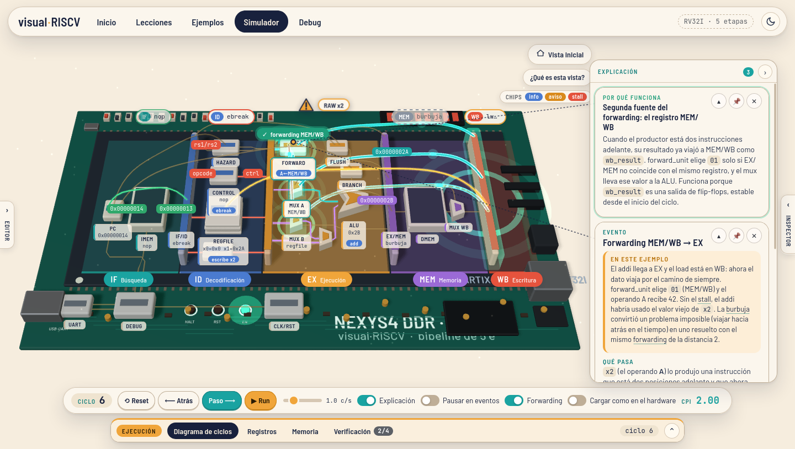

## Qué incluye

- **Inicio** con dos recorridos (Entender este chip / Construí tu propio RISC-V), el simulador y la consola de debug.
- **Simulador fiel al RTL** (`src/sim/`): stalls load-use (incluido el "stall falso" del RTL), forwarding EX/MEM y MEM/WB,
  bypass WB→ID del regfile, flush por salto/jump, halt con `ecall`/`ebreak`. Se puede volver atrás ciclo a ciclo.
- **Dos representaciones, para no confundirse**: la *Vista general* es un diagrama simplificado del datapath (bloques
  agrupados por etapa; no es un módulo de Verilog) es la única raíz: de ahí cuelga cada módulo (incluido el bloque "CLK/RST" con
  el MMCM y el reset). Las migas dicen dónde vive cada uno en el RTL real ("en el RTL: top_riscv › u_cpu › u_alu"), y el botón
  "¿Qué es esta vista?" explica `top_riscv` y `riscv_pipeline`.
- **Zoom por dentro de cada módulo**: un clic en un bloque abre el inspector (explicación desde cero, cómo lo resuelve este
  RTL, por qué esa elección, alternativas, señales en vivo, links a GitHub) y entra a su interior. Las migas
  ("Vista general › alu_tp1", con el tipo de cada nivel) y `Esc` suben un nivel; los submódulos se
  atraviesan con clic. Hay FSMs con grafo, y un simulador de bytes para la UART.
- **Hazards visibles**: triángulo de aviso en la etapa afectada ("RAW x5", "load-use x2", "control: bne tomado", "stall
  falso"), el hardware que lo resuelve se ilumina y aparece "Por qué funciona". Los bloques muestran chips de estado solo
  cuando hay algo que decir (`stall (load-use)`, `A←EX/MEM`, `lee x5,x6`, `tomado → 0x2C`...), con leyenda.
- **Modo explicación**: en cada paso aparece la teoría del evento más interesante, la nota del ejemplo ("En este
  ejemplo") y la ficha de la instrucción que entra a ID, con "Otras opciones de hardware" (modal grande).
- **Dock de ejecución** (abajo): Diagrama de ciclos, Registros, Memoria y **Verificación** (esperado vs obtenido con ✓/✗,
  en vivo y al terminar, qué demuestra sobre el hardware y cómo se verifica el diseño real con un modelo de referencia).
- **Editor de ensamblador** RV32I con pseudoinstrucciones: se ensambla solo al escribir, con errores en la línea y
  resaltado de la instrucción de cada etapa. Opción "Cargar como en el hardware": anima la transferencia UART → debug
  unit → memoria de instrucciones.
- **Lecciones** en una sola vista con scroll: intro, secciones, "Qué mirar en la animación", links al repo y "Cargar
  ejemplo". El recorrido de construcción trae una lista de preparación (se guarda en el navegador) y programas de prueba por
  categoría con su resultado esperado.
- **LEDs de la placa** con tooltip (HALT / RST / EN y su señal en `top_riscv.v`).
- **Vista Debug**: consola con el protocolo real de la debug unit (`L`, `S`, `R`, `P`, `X`, `D`) a 19200 baudios.
- Glosario con tooltip, tema claro y oscuro, adaptable a móviles.

| Verificación | Registros |
| --- | --- |
| 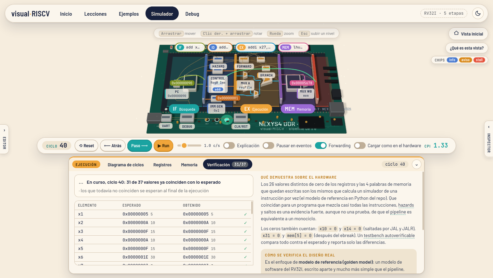 | 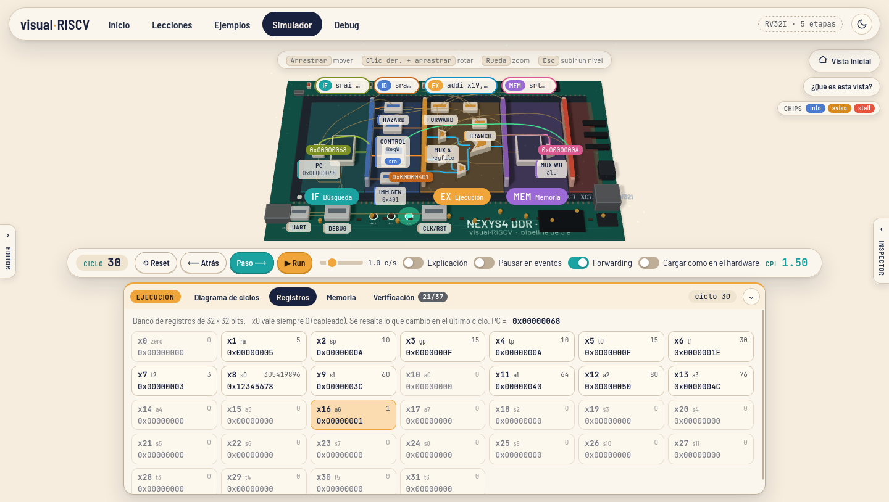 |

| Inspector de un módulo (el riel de explicación pasa al lado libre) | Por dentro de la ALU |
| --- | --- |
| 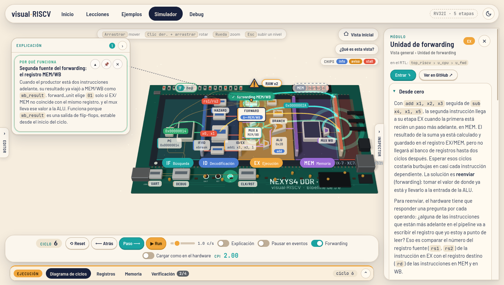 | 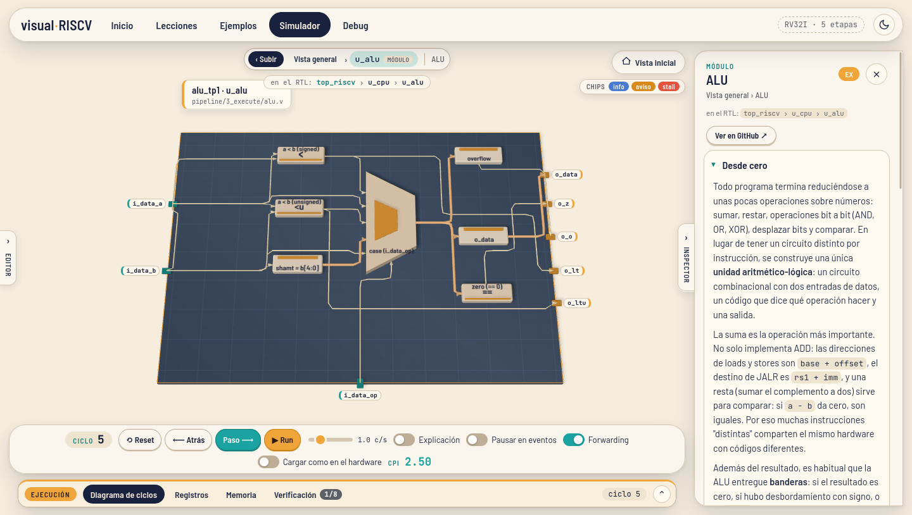 |

| Zoom cercano (títulos decal + valores en vivo) | Alternativas de hardware |
| --- | --- |
| 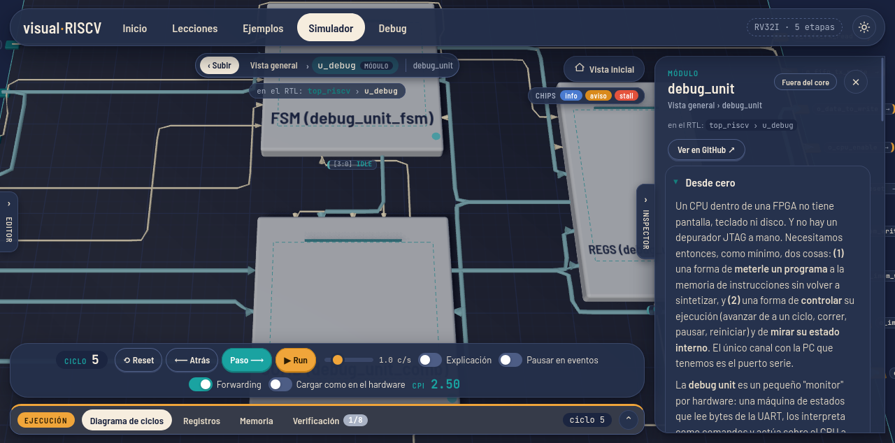 | 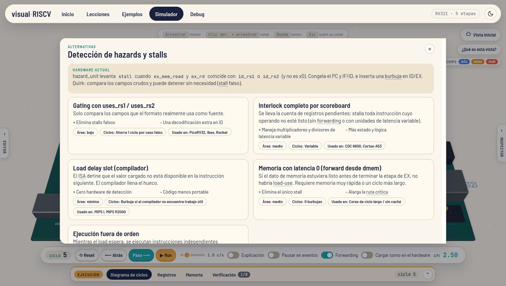 |

| LEDs | Inicio |
| --- | --- |
| 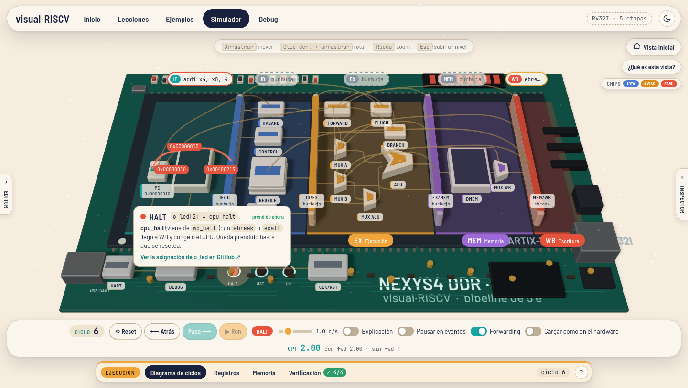 | 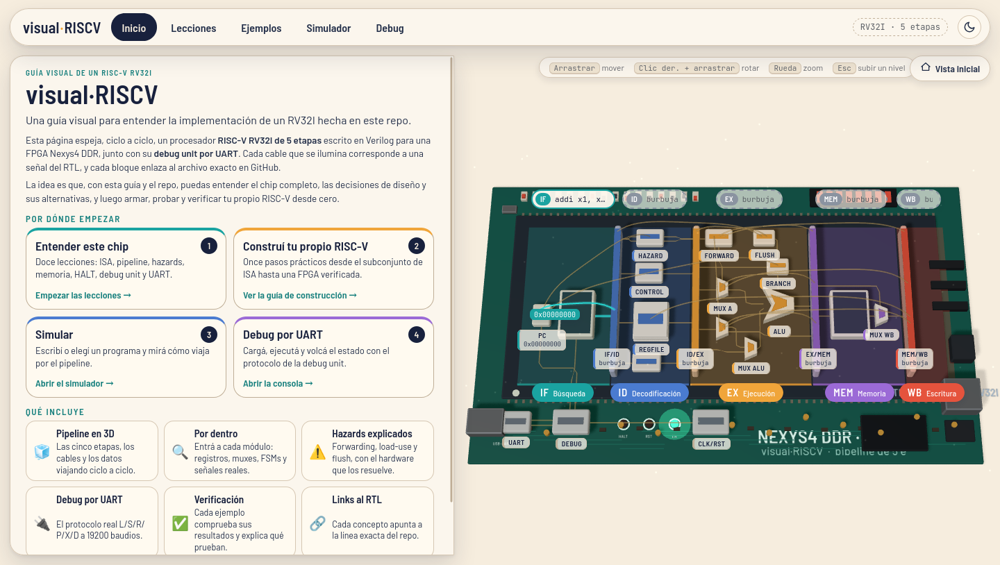 |

| Lección | Construí tu propio RISC-V |
| --- | --- |
| 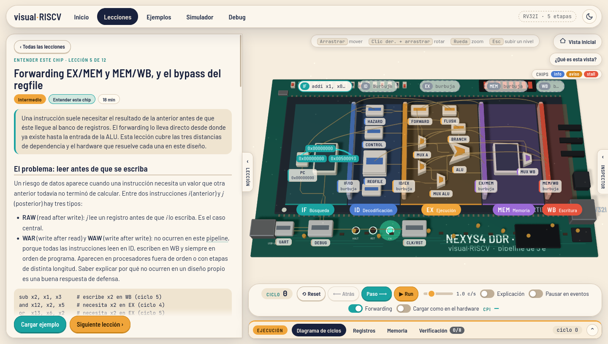 | 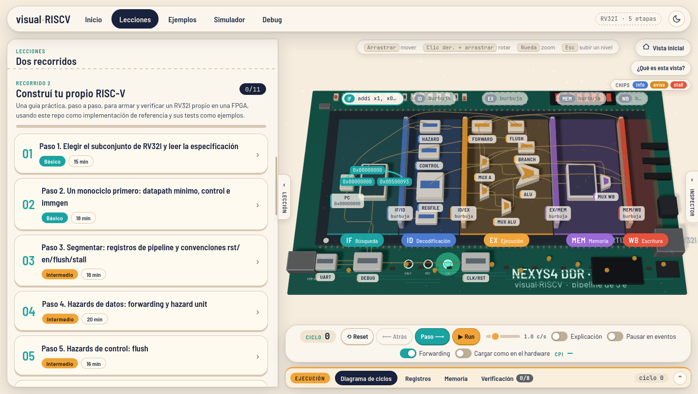 |

| Salto tomado, tema oscuro | Móvil (hoja inferior de explicación) |
| --- | --- |
| 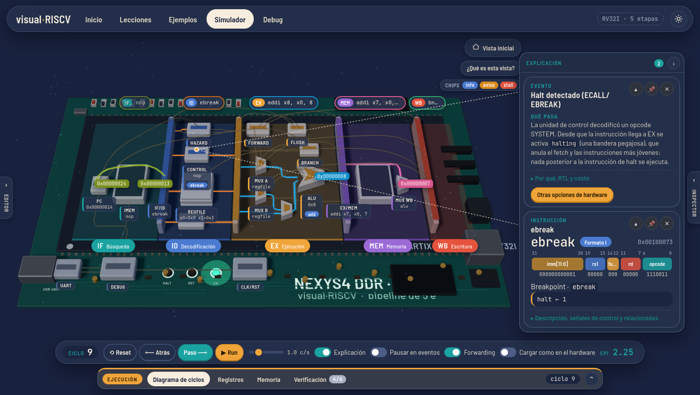 | 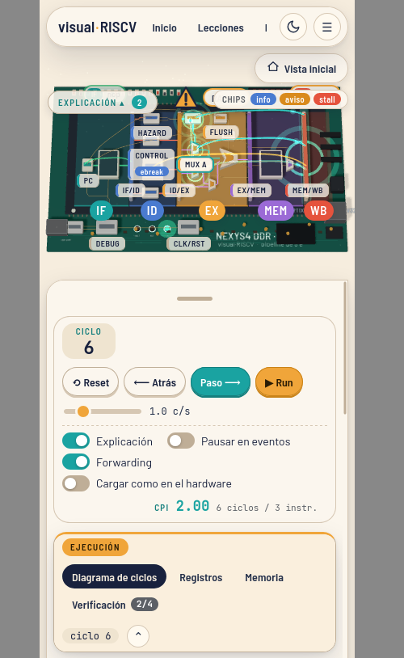 |

| Debug: carga por UART (comando L) a mitad de camino | Vista general: "¿Qué es esta vista?" |
| --- | --- |
| 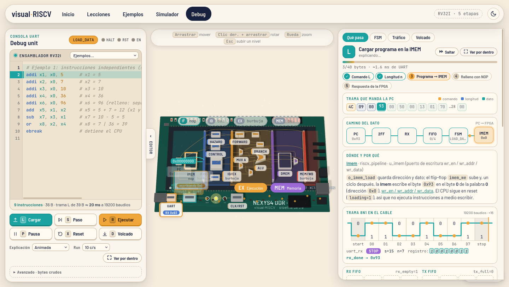 | 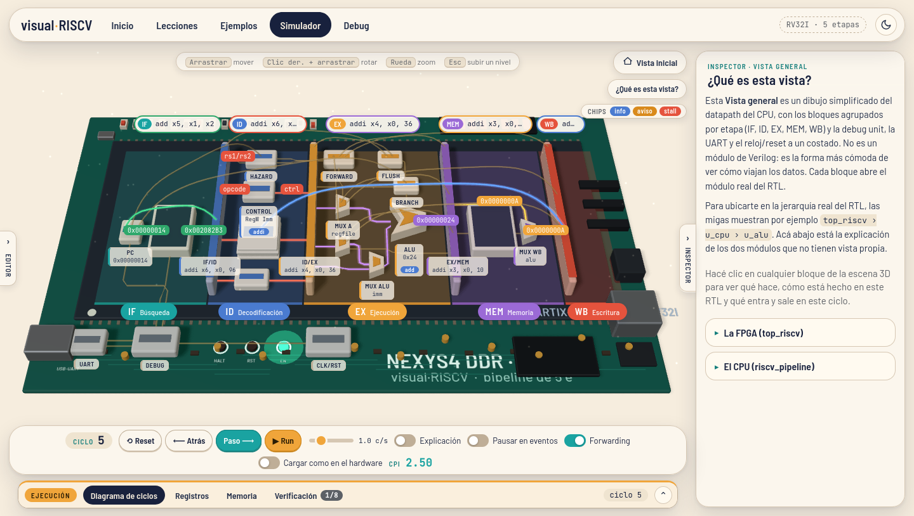 |

| Bloque CLK/RST y migas con la ruta real del RTL | Editor con resaltado de sintaxis |
| --- | --- |
| 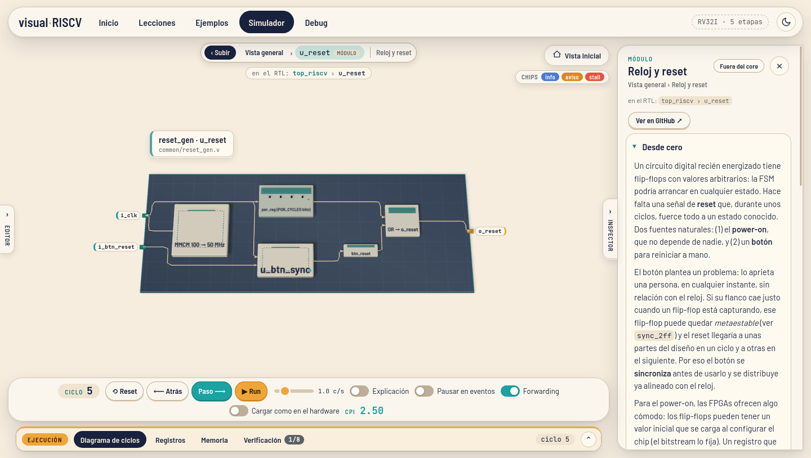 | 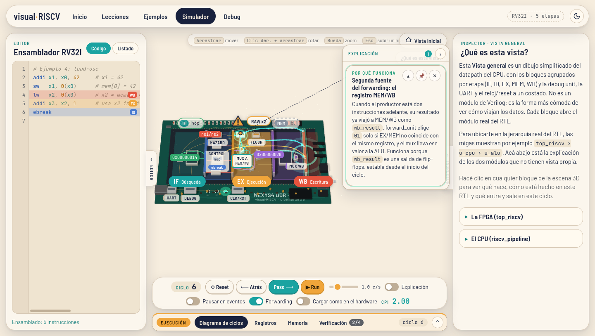 |

## Controles

- **Cámara**: arrastrar = mover, clic derecho + arrastrar = rotar, rueda = zoom. `Esc` sube un nivel dentro de un módulo.
- **Simulador**: editor a la izquierda (pestaña lateral), inspector a la derecha, dock de ejecución abajo.
- **Paso / Run / Atrás / Reset**, velocidad, *Explicación*, *Pausar en eventos*, *Forwarding* (apagarlo es una alternativa
  didáctica) y *Cargar como en el hardware*.

## Rendimiento (`?perf`)

Con `?perf` en la URL aparece un panel con fps reales (cuadros renderizados), ms de CPU por cuadro, draw calls y triángulos. La escena
renderiza solo cuando algo cambia; las animaciones ambientales (cables activos, polvo, brillo de silicio) van a 30 fps. Las etiquetas
DOM no leen layout en el bucle (tamaños cacheados, nivel de detalle por zoom, solo se escribe lo que cambia). Draw calls / triángulos
antes → después: placa 239 / 37k → 104 / 26k; ALU 67 / 15.7k → 25 / 9.2k.

## Uso

Requiere Node.js 18 o superior.

```bash
npm install
npm run dev      # servidor de desarrollo en http://localhost:5173
npm test         # tests del simulador (vitest)
npm run build    # genera dist/
npm run preview  # sirve dist/ para probarlo
npm run rtl-index # regenera src/content/rtl-index.json desde el RTL (RTL_ROOT=<ruta a sources_1/new>)
```

## Deploy

El build es estático (`base: './'` en `vite.config.js`), así que funciona en cualquier hosting y bajo subcarpetas.

- **Vercel**: importar el repositorio; detecta Vite solo (build `npm run build`, salida `dist`). No hace falta `vercel.json`.
- **Netlify**: importar el repositorio (build `npm run build`, publish `dist`) o arrastrar la carpeta `dist/` a
  [app.netlify.com/drop](https://app.netlify.com/drop).
- **GitHub Pages**: activar *Settings > Pages > Source: GitHub Actions*; el workflow
  [`.github/workflows/deploy.yml`](.github/workflows/deploy.yml) corre los tests, compila y publica en cada push a `main`.

## Estructura

```
index.html            entrada (parámetros ?debug / ?shot / ?script para depurar)
src/main.js           integración: sim + contenido + escena + UI
src/sim/              simulador: pipeline, ensamblador, desensamblador, debug unit, programas
src/content/          texto didáctico: ISA, teoría de eventos, alternativas, bloques, ejemplos, lecciones, vistas internas por módulo
                      rtl-index.json: índice del RTL (módulos, señales, líneas) generado con `npm run rtl-index`;
                      los links a GitHub son permalinks al commit indexado (REPO.ref), nunca números de línea escritos a mano
src/scene/            escena three.js: placa, bloques, cables, paquetes, cámara
src/ui/               paneles: editor, controles, timeline, dock de ejecución, inspector, migas, pop-ups, lecciones, inicio, consola de debug
tests/                tests del simulador (vitest)
CONTRACT.md           contrato entre módulos (ids de bloques y cables, forma de los snapshots)
docs/screenshots/     capturas
```

## Correspondencia entre el simulador y el RTL

Las rutas son relativas a `project_4.srcs/sources_1/new/` del proyecto Vivado.

| Simulador (`src/sim/`) | RTL |
| --- | --- |
| `pipeline.js`: PC, fetch, `stopFetch` | `pc.v`, `pipeline/1_fetch/imem.v`, `pipeline/riscv_pipeline.v` |
| `isa.js`: `decodeControl`, `immGen`, `aluCompute`, `branchTaken` | `pipeline/2_decode/control.v`, `immgen.v`, `pipeline/3_execute/alu.v`, `alu_ops.vh`, `branch_unit.v` |
| `pipeline.js`: regfile con bypass WB→ID | `pipeline/2_decode/regfile.v` |
| `pipeline.js`: hazard / forward / flush | `pipeline/flow/hazard_unit.v`, `forward_unit.v`, `flush_unit.v` |
| `pipeline.js`: dmem con byte lanes | `pipeline/4_memory/dmem.v` |
| `pipeline.js`: registros de pipeline, `dbgRead` | `pipeline/regs/pipe_reg.v`, bus de debug de `riscv_pipeline.v` |
| `debugUnit.js`: FSM, `encodeLoad`, `decodeDump` | `debug/debug_unit_fsm.v`, `debug_unit_comb.v`, `debug_unit_regs.v` y `host/debug_protocol.py` |
| `programs/pipeline_test.s` | programa de prueba del proyecto (`host/tests/pipeline_test.s`) |

El modo "sin forwarding" del simulador es una alternativa didáctica, no existe en el RTL. Cuando el RTL y algún
README no coinciden, el simulador sigue al RTL.

## Parámetros de URL (para depurar y capturar)

`?view=sim|debug|lessons|examples|home`, `?enter=alu_tp1` (entrar a una vista interna), `?focus=part:<id>|net:<id>`, `?dock=cycles|regs|mem|verif`, `?track=entender|construir`, `?nobanner`,
`?view=sim`, `?theme=dark`, `?example=load-use`, `?steps=4`, `?explain`, `?alt=hazard`,
`?blockclick=alu`, `?script=step,step,click:alu,dbg:L,dbg:R,delay:2000,dbg:D` y `?debug` (muestra errores en pantalla).
Con `?shot` el canvas WebGL se copia a una imagen para poder sacar capturas con Firefox headless.

## Créditos

Teoría de base: [RISC-V from scratch](https://ecrionix.org/riscv-from-scratch/) (ecrionix.org).
Fuentes: Barlow, Barlow Semi Condensed y JetBrains Mono (`@fontsource`). Gráficos 3D: [three.js](https://threejs.org/).
